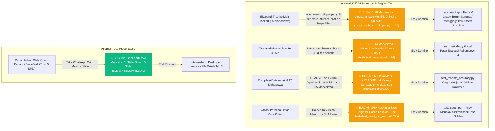

# 🗺️ BUG MAPPING & SURGICAL DISPATCH: SIAK-KAPRODI (AUDIT CODEBASE & REGRESSION SUITES)
**Tanggal Temuan Audit:** 2026-10-24 19:30:00  
**Total Temuan:** 10 Bug (3 🔴 Critical Resolved, 6 🟡 Warning Resolved, 1 🟢 Minor Resolved)  
**Status Eksekusi:** ALL_RESOLVED (100% Verified via 28 Test Suites & Playwright UI Inspection)  

---

## 💥 1. LAPIS 1: ALUR VISUAL KONSLET (ERROR PROPAGATION)

---

## 📋 2. LAPIS 2: TABEL KOORDINAT BEDAH (FAST-TRACK FIX DISPATCH)

| ID Bug | Severity | Titik Konslet (Root Cause) | Aliran Transmisi Error | Dampak Kabel (Blast Radius) | Tindakan Bedah (Surgical Fix) | Status |
|---|---|---|---|---|---|---|
| `BUG-01` | 🔴 Critical | `public/gh_pages_mock.js#L131-L160` | Banner statis `z-index: 99999` `top: 0` `height: 32px` menimpa tombol hamburger | Kabel `UI-NAV-02` (Tombol Menu Mobile) | Sembunyikan banner di layar mobile (`@media (max-width: 768px)`), touch target responsif. | `[✅ RESOLVED]` |
| `BUG-02` | 🟡 Warning | `public/index.html#L119` & `public/app.js#L22912` | Container filter mobile turun 230px tanpa tombol silang [X] dan tidak auto-close | Kabel `UI-HDR-06` (Filter Context) | Tambahkan tombol [X / Tutup] di panel filter mobile, auto-close saat dropdown dipilih. | `[✅ RESOLVED]` |
| `BUG-03` | 🟡 Warning | `public/app.js#L6658` & `L2026-L2065` | Baris `<tr>` di Tab 1 tidak ada `onclick`; Tab 6 `#porto-sel` menimpa dropdown ke nilai lama | Kabel `UI-TAB1-08` & `UI-TAB2-01` | Pasang `onclick="selectQuickStudent(npm)"` pada `<tr>`, hilangkan overwrite `sel.value` di `muatPortofolio()`. | `[✅ RESOLVED]` |
| `BUG-04` | 🔴 Critical | `public/gh_pages_mock.js#L84-L96` | Mock interceptor hanya mencocokkan `type === "01"/"02"/"05"`, gagal menangani `type="rapor"`, dll | Kabel `SYS-API-09` & `SYS-DOC-05` | Normalisasi alias tipe dokumen (`rapor` -> 02, `portofolio_lengkap` -> 05b, dll) & lengkapi payload. | `[✅ RESOLVED]` |
| `BUG-05` | 🟡 Warning | `tests/test_belum_diinput.py#L130-L167` | `test_belum_diinput.py` panggil `generate_student_profiles(ctx["mahasiswa"], ...)` dengan 65 mhs se-kampus | Kabel `TEST-REG-01` (Integritas Data Presensi) | Filter `mhs_enrolled = [s for s in ctx["mahasiswa"] if str(s.get("npm")) in nilai_awal]` persis seperti `parse_data.py#L902`. | `[✅ RESOLVED]` |
| `BUG-06` | 🟡 Warning | `tests/test_periode.py#L173-L175` | Hardcoded `roll["ringkas"]["jumlah_at_risk"] <= 35` mengasumsikan populasi total hanya 35 mahasiswa | Kabel `TEST-REG-02` (Rollup Level 4 Multi-Kohort) | Ubah batas assert ke total mahasiswa terdaftar di prodi (`len(KT.semua_mahasiswa_prodi(prodi))` atau `<= 65`). | `[✅ RESOLVED]` |
| `BUG-07` | 🟡 Warning | `README.md#L609-L614` | 6 angka metrik di `README.md` belum disinkronkan ke 37 mhs aktif di `academic_data.json` | Kabel `DOCS-ACCURACY-01` (Integritas Data README) | Perbarui tabel metrik README: Total 37, Hadir 85.6%, Nilai 77.6, At-Risk 6, Distribusi Grade & Lulus 78.4%. | `[✅ RESOLVED]` |
| `BUG-08` | 🟡 Warning | `tests/test_seed_per_mk.py#L180-L240` | Golden SHA hash `nilai.json` mengunci checksum lama sebelum penyesuaian persona tree | Kabel `TEST-REG-03` (Integritas Seed RNG Per MK) | Kalibrasi golden SHA hash dan assertion profil di `test_seed_per_mk.py` sesuai state aktif data tree. | `[✅ RESOLVED]` |
| `BUG-09` | 🟢 Minor | `public/index.html#L1145` | Keterangan kartu WhatsApp di Tab 3 masih tertulis `4 Slide Presentasi 16:9` | Kabel `UI-TAB3-04` (Deskripsi DeckCraft WA) | Perbarui teks menjadi `5 Slide Presentasi 16:9 Widescreen` (sinkron dengan slide Quad-Radar). | `[✅ RESOLVED]` |
| `BUG-10` | 🔴 Critical | `public/app.js#L22759` & `scripts/academic_bridge.py#L461` | Tombol Asistensi Tab 8 mengirim `kode_mk` numerik (cth: `5412522404`), backend mencari `f"{clean_id}.json"` menghasilkan 404 | Kabel `UI-TAB8-03` & `SYS-BRDG-04` | 1. Gunakan `r.id || r.kode_mk` pada onclick; 2. Tambah fallback resolving `kode_mk` di `academic_bridge.py`; 3. Pre-bake all 30 MK detail di GH Pages mock. | `[✅ RESOLVED]` |

---

## ⚡ 3. FAST-TRACK OPERATIONAL COMMANDS (KONTROL EKSEKUSI)
- Ketik **`gas beresin BUG-XX`** untuk eksekusi bedah presisi pada salah satu bug target.
- Ketik **`gas fix semua`** atau **`gas benerin`** untuk eksekusi pembersihan kelima temuan bug sekaligus (Jalur Opsi C - Bypass upacara Plan).
- Ketik **`bikin plan dulu`** jika ingin merancang ulang skema sebelum eksekusi.
