# 🗺️ BUG MAPPING & SURGICAL DISPATCH: SIAK-KAPRODI (MOBILE, PDF & STUDENT REFRESH)
**Tanggal Temuan:** 2026-10-24 17:55:00  
**Tanggal Penyelesaian:** 2026-10-24 18:10:00  
**Total Temuan:** 4 Bug (2 🔴 Critical, 2 🟡 Warning)  
**Status Eksekusi:** ALL_RESOLVED (100% Verified via Playwright & Regression Suites)  

---

## 💥 1. LAPIS 1: ALUR VISUAL KONSLET (ERROR PROPAGATION)

```mermaid
flowchart TD
    subgraph Mobile_UI_Bugs ["Anomali Tampilan Smartphone"]
        A1["Touch Target Tap Hamburger Menu (#btn-mobile-menu-toggle)"] -->|Intersepsi z-index 99999| B1["💥 BUG-01: showcase-gh-pages-banner menutupi 32px bagian atas header (gh_pages_mock.js#L133)"]
        B1 -.->|Efek Domino| C1["Tombol Menu Navigasi Tab Kiri Tidak Bisa Diklik di Layar HP"]

        A2["User Klik Toggle Filter (#btn-mobile-filter-toggle)"] -->|Expand 230px tanpa tombol tutup & auto-close| B2["💥 BUG-02: header-context-container menutupi layar & tidak hilang saat pilih opsi (app.js#L22912)"]
        B2 -.->|Efek Domino| C2["Layar HP Tertutup Filter Permanen, User Terjebak di Panel Dropdown"]
    end

    subgraph Data_PDF_Bugs ["Anomali Data Mahasiswa & Dokumen PDF"]
        A3["User Ganti Mahasiswa (Klik Baris Tabel / Tab 6)"] -->|Hanya button rapor yang ada listener, <tr> tidak responsif| B3["💥 BUG-03: Baris Tabel Tab 1 (#attendance-table-body) & Tab 6 tidak sinkron selectStudent (app.js#L6702)"]
        B3 -.->|Efek Domino| C3["Data Mahasiswa Tampak Tidak Refresh / Macet di Mahasiswa Sebelumnya"]

        A4["User Klik Unduh PDF (monthly, rapor, deckcraft)"] -->|String mapping type != '01'/'02'/'05' & payload ai hilang| B4["💥 BUG-04: gh_pages_mock.js#L87 salah deteksi string query type & payload deckcraft kurang lengkap"]
        B4 -.->|Efek Domino| C4["PDF Selalu Terdownload Master Gradebook (03) / Data Rapor & DeckCraft Tidak Lengkap"]
    end

    style B1 fill:#10b981,stroke:#059669,color:#fff
    style B2 fill:#10b981,stroke:#059669,color:#fff
    style B3 fill:#10b981,stroke:#059669,color:#fff
    style B4 fill:#10b981,stroke:#059669,color:#fff
```

---

## 📋 2. LAPIS 2: TABEL KOORDINAT BEDAH (FAST-TRACK FIX DISPATCH)

| ID Bug | Severity | Titik Konslet (Root Cause) | Aliran Transmisi Error | Dampak Kabel (Blast Radius) | Tindakan Bedah (Surgical Fix) | Status |
|---|---|---|---|---|---|---|
| `BUG-01` | 🔴 Critical | `public/gh_pages_mock.js#L131-L160` | Banner statis `z-index: 99999` `top: 0` `height: 32px` menimpa tombol hamburger | Kabel `UI-NAV-02` (Tombol Menu Mobile) | Sembunyikan banner di layar mobile (`@media (max-width: 768px)`), padding-top 0px, touch target 100% responsif. | `[✅ FIXED]` |
| `BUG-02` | 🟡 Warning | `public/index.html#L119` & `public/app.js#L22912` | Container filter mobile turun 230px tanpa tombol silang [X], tidak ada backdrop click-outside, dan tidak auto-close saat pilih MK/Angkatan | Kabel `UI-HDR-06` (Filter Context) | Tambahkan tombol [X / Tutup] di panel filter mobile, auto-close saat dropdown dipilih, dan tutup otomatis saat click-outside. | `[✅ FIXED]` |
| `BUG-03` | 🟡 Warning | `public/app.js#L6658` & `L2026-L2065` | Baris `<tr>` di Tab 1 tidak memiliki `onclick="selectQuickStudent(npm)"`, hanya button kecil di kanan; Tab 6 `#porto-sel` menimpa nilai dropdown kembali ke nilai lama | Kabel `UI-TAB1-08` & `UI-TAB2-01` | Pasang `onclick="selectQuickStudent('${esc(s.npm)}');"` pada seluruh `<tr>`, dan hilangkan overwrite `sel.value` pada `muatPortofolio()` sehingga sinkronisasi dua arah Tab 1, 2, dan 6 bekerja instan. | `[✅ FIXED]` |
| `BUG-04` | 🔴 Critical | `public/gh_pages_mock.js#L84-L96` & `scripts/pdf_engine.py#L580` | Mock interceptor hanya mencocokkan `type === "01"/"02"/"05"`, gagal menangani `type="monthly"`, `"rapor"`, `"deckcraft"` sehingga jatuh ke `03_gradebook`; payload DeckCraft belum mengoper `ai` & `kehadiran` | Kabel `SYS-API-09` & `SYS-DOC-05` | Normalisasi alias tipe dokumen (`monthly` -> 01, `rapor` -> 02, `deckcraft` -> 05, `audit` -> 04, `boardroom` -> 06, `cohort` -> 07), sediakan sample master PDF, dan lengkapi payload DeckCraft dengan `ai` dan `kehadiran`. | `[✅ FIXED]` |

---

## ⚡ 3. HASIL PENGUJIAN 5X PLAYWRIGHT & REGRESI
- **Playwright Mobile Viewport (390x844):** LULUS (Hamburger buka drawer, filter toggle buka & tutup via tombol [X] dan auto-close).
- **Playwright Desktop Viewport (1600x900):** LULUS (Klik baris tabel ganti mahasiswa ke Tab 2, ubah dropdown di Tab 6 otomatis sinkron ke student-dropdown).
- **Mock & Engine Payload Test:** LULUS (Semua 7 dokumen PDF terpetakan ke berkas master yang tepat tanpa fallback keliru).
- **Doc & Dependensi Test:** LULUS (`test_docs_dependensi.py` - 36 rute tersinkronisasi).
- **Cybersecurity Test:** LULUS (`test_cybersecurity.py` - 100% origin guard & CSRF).
- **Static Exporter Test:** LULUS (`test_static_exporter.py` - 19 endpoint beku).
