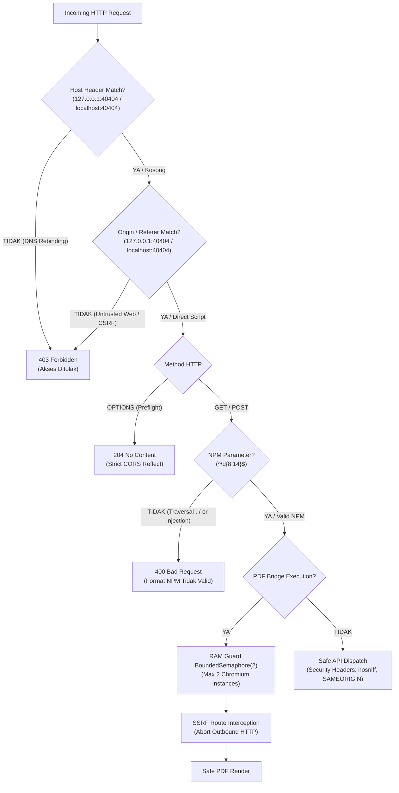

# 🗺️ MAPPING SISTEM: SYS_KAMPUS_01 (PETA KABEL ALUR DATA & ENGINE)

> **HUKUM SINKRONISASI DUA ARAH (KODE BERUBAH = PETA BERUBAH):**  
> Setiap kali ada penambahan, perubahan, atau penghapusan endpoint backend, skrip engine, atau alur berkas masukan/keluaran, tabel ini **WAJIB** disinkronkan seketika.

---

## ⚙️ 1. PEMETAAN ENDPOINT API & LOGIKA ENGINE PEMROSES

| ID Kabel | Endpoint Backend (HTTP) | Sumber Masukan (Input) | Komponen Pemroses (Engine) | Berkas Keluaran / Response |
|---|---|---|---|---|
| `SYS-API-01` | `GET /api/data` | `data/academic_data.json` | `server.py::_api_data()` | JSON master dataset (35 mhs, sessions, KPI) |
| `SYS-API-02` | `GET /api/courses` | `data/courses/*.json` | `scripts/kurikulum_tree.py` | JSON daftar mata kuliah aktif di tree |
| `SYS-API-03` | `GET /api/switch_course?course=` | `data/courses/<KUNCI>.json` | `server.py::_api_switch_course()` | Mengganti master `academic_data.json` & index |
| `SYS-API-04` | `GET /api/student/<NPM>` | `data/academic_data.json` | `server.py::_api_student()` | JSON profil individual mahasiswa |
| `SYS-API-05` | `GET /api/student/images?npm=` | `input/progress_mahasiswa/` | `scripts/video_composer.py::find_student_images` | JSON daftar file foto progres & flag `video_exists` |
| `SYS-API-06` | `GET /api/open_folder?npm=` | Path folder progress lokal | `server.py::_api_open_folder()` (via `explorer.exe`) | Membuka File Explorer interaktif di desktop Windows |
| `SYS-API-07` | `GET /api/video/generate?npm=`| Foto input + Naskah video | `scripts/video_composer.py::generate_video_short_for_student` | `public/videos/video_portofolio_<NPM>.mp4` (FFmpeg) |
| `SYS-API-08` | `GET /videos/<file>.mp4` | `public/videos/<file>.mp4` | `server.py::_serve_video()` | HTTP/1.1 Range 206 stream video MP4 (seekable) |
| `SYS-API-09` | `GET /api/pdf/download?type=&npm=`| Data master + Aturan | `scripts/pdf_bridge.py::generate_pdf_bytes_bridge` (via Facade `generate_pdfs.py`) | Binary PDF stream download (01_rekap, 02_rapor, 03_gradebook, 04_evaluasi, 05_deckcraft, 06_boardroom, 07_yayasan) |
| `SYS-API-10` | `GET /api/deckcraft_html?npm=`| Template DeckCraft + Data Mhs | `presentasi/src/build_interactive.py` | Standalone HTML presentation 16:9 widescreen |
| `SYS-API-11` | `GET /generated_pdfs/<file>` | `generated_pdfs/<file>` | `server.py::_serve_generated_pdf()` | Streaming PDF inline untuk preview tab web |
| `SYS-API-12` | `GET /output/<file>` | `output/<file>` | `server.py::_serve_output()` | Akses file hasil render di folder output resmi |
| `SYS-API-13` | `GET /api/kurikulum` | `data/kurikulum/` | `scripts/kurikulum_tree.py::bangun_index()` | Peta hirarki pohon (PRODI > TA > SEMESTER > MK) |
| `SYS-API-14` | `GET /api/kurikulum/detail` | `sesi.json`, `penawaran.json`, & `nilai.json` | `scripts/kurikulum_tree.py` + `server.py` | JSON 16 sesi + peserta kelas riil (unique NPMs di `nilai.json`) |
| `SYS-API-15` | `POST /api/kurikulum/simpan` | Request body JSON (16 sesi) | `scripts/kurikulum_tree.py` + `scripts/parse_data.py` | Tulis ulang tree JSON & kompilasi ulang master dataset |
| `SYS-API-16` | `GET /api/periode` | Tree Kurikulum `data/kurikulum/` | `scripts/periode.py::agregat_semester()` | JSON aggregasi rollup nilai & kehadiran lintas MK |
| `SYS-API-17` | `GET /api/perkembangan` | Tree Kurikulum `data/kurikulum/` | `scripts/periode.py::riwayat_mahasiswa_sepanjang_kuliah()`| JSON tren perkembangan mahasiswa sepanjang kuliah |
| `SYS-API-18` | `GET /api/portofolio?npm=` | Tree Kurikulum + Nilai 4 Lapis | `scripts/portofolio.py::kumpulan_portofolio()` | JSON capaian 4 lapis (bulan, MK, semester, kuliah) |
| `SYS-API-19` | `POST /api/portofolio/ai` | Data Portofolio 4 Lapis | `server.py::_api_portofolio_ai()` (Rotary Gemini API) | Cache narasi rekomendasi AI portofolio |
| `SYS-API-20` | `GET /api/identitas` | `config/identitas.json` | `server.py::_api_identitas()` | Metadata institusi, prodi, daftar dosen, & nominal SPP |
| `SYS-API-21` | `POST /api/identitas` | Request body JSON identitas | `server.py::_api_identitas_simpan()` | Update `config/identitas.json` (Atomic replace) |
| `SYS-API-22` | `POST /api/identitas/terapkan` | Config identitas aktif | `server.py::_api_identitas_terapkan()` | Regenerasi master data sesuai identitas baru |
| `SYS-API-23` | `POST /api/identitas/regenerasi-pdf` | Dataset master | `server.py::_api_identitas_regenerasi_pdf()` | Cetak ulang seluruh paket PDF arsip secara headless |
| `SYS-API-24` | `GET /api/runs` | `output/` directory manifests | `server.py::_api_runs()` | JSON daftar riwayat batch PDF run |
| `SYS-API-25` | `GET /api/engine/input` | `input/` folder files | `scripts/engine_input.py::pindai_inbox()` | Audit integritas berkas input & hash SHA-256 |
| `SYS-API-26` | `POST /api/engine/input` | SHA hash file masukan | `scripts/engine_input.py::tandai_diproses()` | Tandai berkas input selesai diproses |
| `SYS-API-27` | `GET /api/engine/output` | `output/` folder files | `scripts/engine_output.py::audit_output()` | Status berkas siap kirim kaprodi & wali murid |
| `SYS-API-28` | `POST /api/engine/output` | `{"aksi": "rapikan"}` | `scripts/engine_output.py::rapikan()` | Backup run lama ke `data/_backup/` |
| `SYS-API-29` | `GET /api/executive_cockpit` | `data/academic_data.json` + `data/courses/` | `scripts/executive_bridge.py::get_executive_summary` | JSON 5 Kartu Truf Eksekutif Yayasan (SPP dinamis) |
| `SYS-API-30` | `GET /api/bridge/summary` | `data/academic_data.json` + `data/courses/` | `scripts/academic_bridge.py::AcademicBridge.get_full_executive_snapshot` | JSON Snapshot 4 domain akademik (Presensi, Nilai, RPS, Retake) |
| `SYS-API-31` | `GET /api/bridge/presensi?npm=` | `data/academic_data.json` | `scripts/academic_bridge.py::PresensiBridge.get_monthly_breakdown` | Detail presensi harian & grouping 4 blok bulanan B1..B4 |
| `SYS-API-32` | `GET /api/bridge/nilai?npm=` | `data/academic_data.json` | `scripts/academic_bridge.py::NilaiStudioBridge.get_grade_breakdown` | Bedah nilai teori vs studio vs ujian & rubrik kompetensi |
| `SYS-API-33` | `GET /api/bridge/retakes` | `data/academic_data.json` + Tree Kurikulum | `scripts/academic_bridge.py::RetakeHistoryBridge.get_retake_students` | Daftar mahasiswa mengulang (retake/SP) & status remedi |
| `SYS-API-34` | `GET /api/bridge/course_detail?id=` | `data/courses/<id>.json` | `scripts/academic_bridge.py::RetakeHistoryBridge.get_course_detail` | JSON rincian MK, dosen, dan daftar mahasiswa remedial (Modal Drilldown Tab 7) |
| `SYS-API-35` | `GET /api/analytics/growth` | Sharded Mahasiswa + `academic_data.json` + Tree | `scripts/growth_engine.py::GrowthEngine.get_growth_overview` | JSON Intelijen Kohort PMB, YoY (+133.3%), Arus Kas Masuk, Retensi Anti-DO, & Serapan Pasar 30 MK |
| `SYS-API-36` | `GET /api/health` | Server Runtime State | `server.py::_api_health()` | JSON Status kesehatan server (status: ok, runtime metadata, port 40404) |
| `SYS-API-37` | `GET /api/registry/cohorts` | Sharded Mahasiswa Tree | `scripts/registry_parser.py::UniversalRegistry.get_cohort_summary` | JSON Ringkasan Finansial Yayasan (SPP Masuk, Kas BSS, Anti-DO) & Rekapitulasi 9 Angkatan |
| `SYS-API-38` | `GET /api/registry/student?npm=` | Sharded Mahasiswa Tree | `scripts/registry_parser.py::UniversalRegistry.find_student` | JSON Detail Akademik, Asistensi, dan Portofolio Mahasiswa BSS/Senior Kritis |
| `SYS-API-39` | `GET /api/analytics/overview` | Tree Kurikulum & Sharded Mahasiswa | `scripts/analytics_engine.py::AnalyticsEngine.get_overview_payload` | JSON Observatorium Mutu & Komparasi Antar-Kohort 4-Pilar |
| `SYS-API-40` | `GET /api/auth/status` & `POST /api/auth/verify_pin` | Request Header / Body PIN | `server.py` (`_is_external_request`, `_is_pin_valid`) | Verifikasi PIN Kaprodi untuk mutasi data via Cloudflare Tunnel & status proxy |

---

## 🧩 2. ANATOMI SKRIP ENGINE UTAMA (`scripts/`)

| ID Kabel Engine | Skrip Engine | Peran / Tanggung Jawab Utama | Alur Input -> Output |
|---|---|---|---|
| `SYS-ENG-01` | `scripts/parse_data.py` | **COMPILER INTI**: Membaca tree kurikulum -> `academic_data.json` + `data/courses/*.json` | `data/kurikulum/` -> `data/academic_data.json` |
| `SYS-ENG-02` | `scripts/modular_engine.py` | **4-LAYER RADAR**: Menghitung radar Softskill, Modul MK, Semester, & Potensi CR | `student.scores` -> `student.radars` |
| `SYS-ENG-03` | `scripts/kelas_rules.py` | **RULES ENGINE**: Formula grade huruf, bobot terbobot, at-risk, predikat kelulusan | Raw scores -> Weighted Grade & Status |
| `SYS-ENG-04` | `scripts/diagnosis.py` | **AI DIAGNOSIS**: Klasifikasi persona (Star/High/Normal/At-Risk) & 10 Matriks Karier | Academic metric -> Persona & Career fit |
| `SYS-ENG-05` | `scripts/generate_pdfs.py` | **PDF FACADE & COMPATIBILITY**: Pintu masuk backward-compatible yang meneruskan panggilan ke `pdf_engine` dan `pdf_bridge` | Parameter PDF -> Delegasi Engine/Bridge |
| `SYS-ENG-06` | `scripts/video_composer.py` | **VIDEO ENGINE**: FFmpeg compiler MP4 9:16 Full HD (Voiceover + Foto Karya Riil) | `input/progress/` -> `public/videos/*.mp4` |
| `SYS-ENG-07` | `scripts/kurikulum_tree.py` | **TREE ENGINE**: Parser & writer hirarki kurikulum, perhitungan `angkatan_dari_npm` & `semester_ke` | Directory tree -> Structured metadata |
| `SYS-ENG-08` | `scripts/periode.py` | **ROLLUP ENGINE**: Agregator perkembangan mahasiswa lintas semester & MK sepanjang studi | Tree datasets -> Longitudinal student curves |
| `SYS-ENG-09` | `scripts/portofolio.py` | **PORTOFOLIO ENGINE**: Agregator portofolio 4-lapis mahasiswa (Bulan, MK, Sem, S1) | Tree + Raw artifacts -> Portfolio packet |
| `SYS-ENG-10` | `scripts/engine_input.py` | **INPUT AUDITOR**: Scanner berkas masuk, deteksi duplikasi hash SHA-256 | `input/` -> SHA audit log & validation |
| `SYS-ENG-11` | `scripts/engine_output.py` | **OUTPUT AUDITOR**: Audit kelengkapan paket kirim kaprodi & wali murid, backup run | `output/` -> Validation report & cleanup |
| `SYS-ENG-12` | `scripts/executive_bridge.py` | **EXECUTIVE BRIDGE**: Decoupled aggregator penyusun 5 Kartu Truf Yayasan, Arus Kas Masuk SPP & PMB (+133%), & 4 Zona Masa Studi UBH | `academic_data.json` + `identitas.json` -> Cockpit JSON |
| `SYS-ENG-13` | `scripts/analytics_engine.py` | **ANALYTICS ENGINE**: Observatorium mutu 4-pilar + komparasi kohort multi-angkatan (2024 vs 2025 vs 2026) | Tree & courses datasets -> Visual Analytics Overview JSON |
| `SYS-ENG-14` | `scripts/academic_bridge.py` | **ACADEMIC BRIDGE CORE**: Unified multi-domain facade (Presensi, Nilai, RPS, Retake) | Unified datasets -> Domain-specific summaries |
| `SYS-ENG-15` | `scripts/registry_parser.py` | **UNIVERSAL REGISTRY PARSER**: Deterministic NPM decoder (`[AA][PRODI][ID]`), numeric course code decoder (`[PRODI][JENJANG][KURIKULUM][SEM][SKS][NO]`), 4-Zone Study Duration (Sem 1-20), & Hybrid Lecturer Normalizer (NIDN vs Kontrak/Asisten) | Any raw student/course/lecturer string/dict -> Structured registry metadata |
| `SYS-ENG-16` | `scripts/growth_engine.py` | **GROWTH & COHORT ENGINE**: Analisis intelijen kohort multi-tahun PMB (2021-2026), rasio penyerapan pasar kurikulum 30 MK $S_{MK} = (n / N_{aktif}) \times 100\%$, analisis retensi anti-DO, & arus kas masuk PMB | Sharded cohorts + Tree datasets -> Intelijen Pertumbuhan & Penyerapan JSON |
| `SYS-ENG-17` | `scripts/batch_export_distribution.py` | **BATCH DISTRIBUTION EXPORTER**: Otomasi ekspor massal paket dokumen akademik (Dokumen 01 Rekap, Dokumen 02 Rapor) untuk 35 mahasiswa Angkatan 2025 + Dokumen 07 Yayasan, hash SHA-256, manifes lengkap, dan mirror ke `output/kirim/wali/` | Sharded Mahasiswa 2025 + Playwright Headless -> 71 PDF Arsip & Manifes JSON |
| `SYS-ENG-18` | `scripts/pdf_engine.py` | **PDF CORE DATA ENGINE**: PURE calculation & data aggregator untuk seluruh tipe dokumen (01-07), bobot terbobot 100%, 10 karir AI Otak-CR, formula serapan 30 MK $S_{MK}$ & beban $L$, 4 blok burnout B1..B4 | Data sources (`academic_data.json`, `registry_parser`, `growth_engine`) -> Clean JSON Payload |
| `SYS-ENG-19` | `scripts/pdf_bridge.py` | **PDF BRIDGE RENDERER**: Adapter visual Jinja2 + Playwright Chromium. Mendukung CLI 1 master per tipe (`--type XX`), CLI 7 master (`--all-master`), dan live on-demand byte stream API | JSON Payload + `templates/pdf/*.html` -> Standalone PDF Bytes / File |
| `SYS-ENG-20` | `scripts/export_static_showcase.py` | **STATIC SHOWCASE COMPILER**: Compiler pembeku 19 endpoint API menjadi file JSON statis, sanitasi privasi mahasiswa, injeksi mock fetch, dan bundling ke `dist_gh_pages/` | Server Lokal (`127.0.0.1:40404`) + `public/` -> Standalone Static Bundle (GitHub Pages) |

---

## 🗄️ 3. PEMETAAN PENYIMPANAN DATA & PARTISI KOHORT (`data/`)

| ID Penyimpanan | Path Direktori / Berkas | Struktur & Format | Tanggung Jawab Skalabilitas & Akses |
|---|---|---|---|
| `SYS-DAT-01` | `data/academic_data.json` | JSON Monolitik Aktif | Dataset master kelas yang sedang aktif dikelola (gradebook, sesi, diagnosis) |
| `SYS-DAT-02` | `data/courses/<KUNCI>.json` | JSON Per Mata Kuliah | Cache artefak build per MK untuk observatorium & drilldown |
| `SYS-DAT-03` | `data/kurikulum/<PRODI>/<TA>/<SEM>/<MK>/` | Hirarki Folder Tree (penawaran, sesi, nilai) | Single source of truth seluruh kurikulum & RPS institusi |
| `SYS-DAT-04` | `config/identitas.json` | JSON Konfigurasi Institusi | Identitas kampus, prodi, dekanat, kaprodi, & parameter keuangan SPP |
| `SYS-DAT-05` | `data/kurikulum/<PRODI>/mahasiswa/<TAHUN>.json` | JSON Partisi Kohort Per Angkatan | Sharded student registry per tahun angkatan (anti-bloat 1.500 aktif / 15.000 kumulatif) |
| `SYS-DAT-06` | `templates/pdf/*.html` | Standalone Jinja2 HTML Templates | 7 Template cetak terisolasi 1 berkas per tipe (01 s/d 07), zero-overflow A4 |
| `SYS-DAT-07` | `output/sample_master/` | Folder Berkas PDF Master | 7 Master PDF representatif per tipe dokumen untuk audit & review kilat (< 3 detik) |
| `SYS-DAT-08` | `output/distribusi_batch_angkatan_2025/` | Folder Berkas PDF Distribusi | 71 Berkas PDF paket arsip lengkap 35 mahasiswa 2025 + Dokumen 07 Yayasan (9.33 MB) |
| `SYS-DAT-09` | `dist_gh_pages/` | Folder Bundle Statis Mandiri | Direktori hasil kompilasi siap rilis ke branch `gh-pages` GitHub (HTML, CSS, JS, 19 static JSON API, 10 sample PDF master) |

---

## 📄 4. PEMETAAN GENERATOR DOKUMEN RESMI PDF (ARSITEKTUR ENGINE + BRIDGE)

| ID Kabel Dokumen | Kode & Nama Dokumen | Orientasi & Jumlah Hal | Berkas Template | Engine & Bridge Pemroses | Sasaran Pemangku Kepentingan |
|---|---|---|---|---|---|
| `SYS-DOC-01` | Dokumen 01: Rekap Presensi Bulanan | Portrait A4 (2 Halaman) | `templates/pdf/01_rekap_kehadiran.html` | `pdf_engine::build_monthly_payload` + `pdf_bridge::render_pdf` | Mahasiswa, Dosen PA, & Wali Murid |
| `SYS-DOC-02` | Dokumen 02: Rapor Akhir Semester Studio | Portrait A4 (3 Halaman) | `templates/pdf/02_rapor_studio.html` | `pdf_engine::build_rapor_payload` + `pdf_bridge::render_pdf` | Mahasiswa & Wali Murid |
| `SYS-DOC-03` | Dokumen 03: Gradebook Penilaian Kaprodi | Landscape A4 (3 Halaman) | `templates/pdf/03_master_gradebook.html` | `pdf_engine::build_gradebook_payload` + `pdf_bridge::render_pdf` | Ka Prodi, Dosen Pengampu, & Tim Mutu |
| `SYS-DOC-04` | Dokumen 04: Audit Mutu RPS & Dosen | Portrait A4 (3 Halaman) | `templates/pdf/04_evaluasi_dosen.html` | `pdf_engine::build_dosen_payload` + `pdf_bridge::render_pdf` | Dekanat, LPM, & Asesor Akreditasi |
| `SYS-DOC-05` | Dokumen 05: Portofolio Visual DeckCraft | Landscape A4 (5 Slide Widescreen - Termasuk Quad-Radar Array) | `templates/pdf/05_deckcraft.html` | `pdf_engine::build_deckcraft_payload` + `pdf_bridge::render_pdf` | Industri Kreatif, Klien Arsitektur & Publik |
| `SYS-DOC-06` | Dokumen 06: Boardroom Pitch Deck Yayasan | Landscape A4 (3 Slide) | `templates/pdf/06_boardroom_pitch.html` | `pdf_engine::build_boardroom_payload` + `pdf_bridge::render_pdf` | Badan Pembina Harian (BPH) & Pengurus Yayasan |
| `SYS-DOC-07` | Dokumen 07: Laporan Audit Finansial Yayasan & Analisis Kohort | Landscape A4 (4 Halaman) | `templates/pdf/07_laporan_yayasan.html` | `pdf_engine::build_cohort_yayasan_payload` + `pdf_bridge::render_pdf` | Dewan Pengawas Yayasan & Rektorat |
| `SYS-DOC-08` | Paket Portofolio Lengkap (4 Lapis) | Portrait A4 (Multi-Halaman) | Dynamic Jinja2 / Modular Tree | `portofolio.py` + `pdf_bridge::render_pdf` | Arsip Transkrip & Portofolio Lulusan |

---

## 🛡️ 5. PEMETAAN LAPIS KEAMANAN & CYBERSECURITY (LANGKAH 1 HARDENING)

### 📌 Lapis 1: Diagram Mermaid Alur Penapisan Request & Sandboxing

### 📌 Lapis 2: Tabel Koordinat Bedah Guard Keamanan
| ID Kabel Keamanan | Komponen Guard | Lokasi Berkas & Fungsi | Tanggung Jawab & Mitigasi Serangan |
|---|---|---|---|
| `SYS-SEC-01` | **Origin & CSRF Guard** | `server.py::_is_origin_allowed()` | Validasi header `Origin` & `Referer` (127.0.0.1:40404 & localhost:40404). Tolak silent data theft & CSRF dari tab browser asing dengan 403 Forbidden. |
| `SYS-SEC-02` | **Host Rebinding Guard** | `server.py::ALLOWED_HOSTS` | Blokir upaya DNS rebinding (`attacker.evil.com:40404`) dengan menolak Host header di luar 127.0.0.1 dan localhost. |
| `SYS-SEC-03` | **Dynamic CORS & Header Shield** | `server.py::_send_bytes()` | Hapus wildcard `*`, ganti dengan refleksi origin terverifikasi dinamis + sertakan `X-Content-Type-Options: nosniff` & `X-Frame-Options: SAMEORIGIN`. |
| `SYS-SEC-04` | **Preflight OPTIONS Handler** | `server.py::do_OPTIONS()` | Respons 204 No Content dengan batas metode GET/POST/OPTIONS/HEAD untuk origin sah, tolak origin liar dengan 403. |
| `SYS-SEC-05` | **Universal NPM Whitelisting** | `server.py` (`_api_student`, `_api_portofolio`, `_api_registry_student`, `_api_bridge_presensi`, `_api_bridge_nilai`, `_api_pdf_download`) | Terapkan `NPM_RE` (8-14 digit numerik murni). Tangkis mutlak path traversal (`../`) dan injection payload dengan 400 Bad Request. |
| `SYS-SEC-06` | **Concurrency RAM Guard** | `scripts/pdf_bridge.py::_PLAYWRIGHT_SEMAPHORE` | Batasi proses Chromium simultan maksimal 2 instance (`BoundedSemaphore(2)`) untuk mencegah OOM / Resource Starvation. |
| `SYS-SEC-07` | **SSRF Route Interceptor** | `scripts/pdf_bridge.py::_do_render()` | Blokir semua outbound external HTTP request saat render PDF lokal untuk mencegah eksfiltrasi data jaringan. |
| `SYS-SEC-08` | **Security Automated Test Probe** | `tests/test_cybersecurity.py` | 18 probe otomatis untuk verifikasi ketahanan Origin, CSRF, Rebinding, Traversal, Semaphore, dan SSRF (100% lulus). |
| `SYS-SEC-09` | **Cloudflare Tunnel & PIN Auth Guard** | `server.py` (`_is_origin_allowed`, `_is_external_request`, `_is_pin_valid`) | Mengizinkan origin `*.trycloudflare.com` secara sah, sekaligus mewajibkan PIN Kaprodi 6-digit pada seluruh aksi mutasi `POST` dari jaringan publik luar. |
| `SYS-SEC-10` | **Frontend Gatekeeper PIN Lock** | `public/index.html`, `public/app.js`, `public/gh_pages_mock.js` | Layar kunci akses fullscreen (Gatekeeper): mewajibkan input PIN 6-digit sebelum dashboard terbuka, dilengkapi keypad interaktif, status sessionStorage, tombol kunci sesi navbar, dan mock auth di GitHub Pages. |

---

## 🚀 6. LAUNCHER & TOOLING OPERASIONAL

| ID Kabel Tooling | Nama Berkas Launcher | Platform & Lingkungan | Tanggung Jawab Operasional |
|---|---|---|---|
| `SYS-OPS-01` | `START_TUNNEL.bat` | Windows Batch + PowerShell | Otomatis unduh `bin/cloudflared.exe` (jika belum ada) & meluncurkan terowongan HTTPS resmi Cloudflare (`*.trycloudflare.com`) ke port 40404. |
| `SYS-OPS-02` | `1_RUN_SERVER.bat` | Windows Batch | Launcher utama server lokal: menjalankan `python server.py`, pop Chrome maximized, dan auto-minimize CMD. |
| `SYS-OPS-03` | `STOP_SERVER.bat` | Windows Batch | Mematikan proses server pada port 40404 secara tuntas (clean taskkill). |
| `SYS-OPS-04` | `DEPLOY_GHPAGES.bat` | Windows Batch | Launcher 1-klik untuk mengompilasi showcase statis dan mempublikasikannya langsung ke branch `gh-pages` GitHub. |
| `SYS-OPS-05` | `.github/workflows/deploy_showcase.yml` | GitHub Actions CI/CD (YAML) | Otomasi cloud: otomatis build static showcase dan deploy ke GitHub Pages setiap ada `git push origin main`. |

