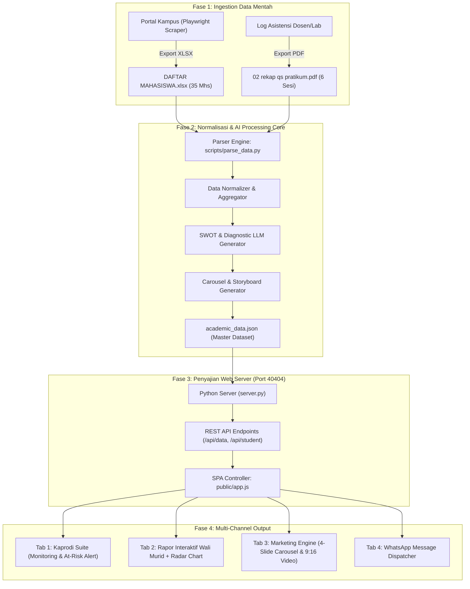

# WORKFLOW MAPPING & ARSITEKTUR SISTEM
## SIAK-KAPRODI (Sistem Intelijen Akademik & Rekap Portofolio Arsitektur)

Dokumen ini memetakan alur data ujung-ke-ujung (End-to-End Pipeline) dari sumber portal kampus hingga menjadi alat monitoring Kaprodi, rapor interaktif wali murid, dan mesin viral marketing media sosial.

---

### 🗺️ Diagram Alur Data Sistem



---

### 🏛️ Pemetaan 4 Modul Fungsional Utama

#### 1. Modul Presensi & Rekap Bulanan (Kaprodi View)
* **Tujuan**: Memberikan visibilitas 100% kepada Kaprodi mengenai disiplin perkuliahan per bulan.
* **Fitur**:
  * KPI Cards: Tingkat kehadiran kelas (%), distribusi status (Hadir, Sakit, Izin, Alpha).
  * Filter Sesi: Pertemuan 1 s/d 6 (AutoCAD dasar, Kolom Dinding, Layer Arsiran, Potongan & Pondasi, Layout A3, Perhitungan Volume).
  * Log Alasan: Setiap ketidakhadiran mencantumkan alasan otentik (surat dokter, delegasi lomba, kendala perangkat).
  * At-Risk Student Alert: Sistem otomatis menandai mahasiswa dengan akumulasi Alpha $\ge 2$ atau kehadiran $< 75\%$ untuk intervensi dini sebelum ujian.

#### 2. Modul Evaluasi Kinerja & Analisis AI (Wali Murid View)
* **Tujuan**: Laporan berkala yang humanis, membanggakan, dan berorientasi masa depan bagi orang tua tanpa stigma urutan ranking buncit.
* **Fitur**:
  * **Profil Indeks Kompetensi Mandiri & Kesiapan Profesi** (Pengganti Ranking Kelas): Menggantikan angka ranking kompetitif dengan indeks kualitatif (`Kompeten Unggul`, `Indeks Kesiapan: 96%`) berstandar Ikatan Arsitek Indonesia (IAI).
  * Pemilihan Mahasiswa Instan: Dapat berganti profil antar 35 mahasiswa secara reaktif.
  * Radar Chart 5 Dimensi: Penguasaan CAD, Ketelitian Detail, Kedisiplinan Asistensi, Logika Ruang/Struktur, Manajemen Waktu.
  * **4 Analisis Naratif Mendalam (Gemini Academic Engine)**:
    1. *Karakter Spasial & Etos Kerja Studio*: Ulasan detail kepekaan rasa ruang, penarikan garis presisi, dan etos kerja di workstation studio.
    2. *Proyeksi Potensi Perkembangan Kedepan*: Proyeksi kesiapan sayembara arsitektur, pemodelan BIM Revit, dan studio perancangan tematik tingkat atas.
    3. *Catatan Khusus Penguatan Mahasiswa*: Arahan teknis konstruktif langsung bagi ananda.
    4. *Panduan Khusus Pendampingan Wali Murid di Rumah*: Langkah konkret pendampingan orang tua (fasilitas perangkat GPU, nutrisi, dan dukungan psikologis).
  * **Matriks 10 Rekomendasi Profesi Riil Masa Depan**: Pemetaan 10 karier nyata industri arsitektur (Architectural Designer, BIM Modeler, QS & Estimator, DED Specialist, Interior Architect, 3D Visualizer, Site Architect, Landscape Designer, Green Building Specialist, Project Planner/Contractor) lengkap dengan persentase kecocokan, keterampilan kunci, dan aksi penguatan.

#### 3. Modul Portofolio Digital & Video Progres Belajar (DeckCraft & Video Story)
* **Tujuan**: Mengubah kebanggaan orang tua menjadi portofolio profesional dan media audio-visual yang siap dipresentasikan atau dibagikan ke keluarga besar.
* **Fitur**:
  * **DeckCraft Presentation Engine (16:9 Widescreen)**: Slide deck portofolio arsitektur elegan 4-slide lengkap dengan diagram vektor aksonometri 3D, denah skala 1:100, potongan pondasi, dan segel verifikasi resmi.
  * **Vertical Video Story (9:16 Shorts/Status)**: Simulasi video gerak vertikal 32 detik dengan narasi voiceover afirmatif, menonjolkan karya nyata dan dedikasi ananda di lab.

#### 4. Modul Simulator Distribusi WhatsApp
* **Tujuan**: Memudahkan pengiriman laporan resmi ke wali murid langsung dari sistem.
* **Fitur**:
  * Format pesan santun dan resmi menyertakan 3 berkas lampiran PDF resmi (`01_rekap_kehadiran_*.pdf`, `02_rapor_akhir_kompetensi_*.pdf`, `05_deckcraft_portofolio_*.pdf`).
  * Tombol 1-klik `Salin Pesan WA` dan `Buka WhatsApp Web`.

#### 5. Modul Generator Dokumen PDF Resmi (Playwright & DeckCraft Engine)
* **Tujuan**: Memproduksi dokumen resmi siap cetak, arsip dekanat, dan berkas pengesahan yudisium.
* **Paket Dokumen**:
  1. `PDF 1A`: **Rekap Kehadiran Mahasiswa Bulanan** (Untuk Wali Murid — Presensi, Alasan, Stempel Resmi).
  2. `PDF 1B`: **Rapor Portofolio Akhir Semester & Pemetaan 10 Karier Masa Depan** (Format 2 Halaman A4 — Page 1: Rapor & 4 Narasi Mendalam; Page 2: Matriks 10 Profesi Riil & Tanda Tangan Resmi).
  3. `PDF 1C / DeckCraft`: **Portofolio Slide Deck Presentasi 16:9 Widescreen** (4 Slide Widescreen per mahasiswa untuk showcase portofolio arsitektur).
  4. `PDF 2`: **Laporan Penilaian Dosen & Master Gradebook 35 Mahasiswa** (Untuk Kaprodi — Format Landscape A4, Nilai Sesi P1-P6, Grade, Kelulusan).
  5. `PDF 3`: **Laporan Evaluasi Dosen & Keselarasan Modul RPS** (Dari Kaprodi ke Dosen — Presensi Tim Dosen 100%, Audit Kesesuaian Kurikulum 96.0%, CPMK & CPL).

#### 6. Modul Manajemen File & Folder Hierarkis
* **Tujuan**: Mengorganisasi input dan output secara simetris dan terisolasi per mata kuliah dan timestamp.
* **Arsitektur Direktori**:
  ```text
  input/
  ├── raw/<NAMA_MATA_KULIAH>/<TIMESTAMP>/           (Excel & Silabus PDF mentah)
  └── processed/<NAMA_MATA_KULIAH>/<TIMESTAMP>/     (Dataset terstandarisasi & manifest)

  output/
  └── <NAMA_MATA_KULIAH>/<TIMESTAMP>/
      ├── 01_rekap_kehadiran_bulanan_*.pdf
      ├── 02_rapor_akhir_semester_*.pdf (2 Halaman: Rapor & Matriks 10 Karier)
      ├── 03_laporan_penilaian_kaprodi_master_gradebook.pdf
      ├── 04_laporan_evaluasi_dosen_dan_kurikulum_rps.pdf
      ├── 05_deckcraft_portofolio_arsitektur_*.pdf
      └── manifest.json (Metadata berkas & ukuran file)
  ```

---

### 🔗 Integrasi dengan Ekosistem OpenCraft MCP (`E:\WORKSHOP\OPEN_CRAFT_MCP`)
Sistem ini terhubung secara arsitektural dengan framework otomasi konten kreatif:
1. **DesignCraft Skill**: Mengotomasi perakitan tata letak grafis dokumen arsitektur dan format rapor.
2. **DeckCraft Skill**: Merender portofolio dan bahan tayang presentasi 16:9 widescreen (`scripts/deckcraft_builder.py`).
3. **FilmCraft / Shorts-Template Skill**: Merender video rekapan vertikal 9:16 menggunakan programmatic timeline dan background music prodi.

