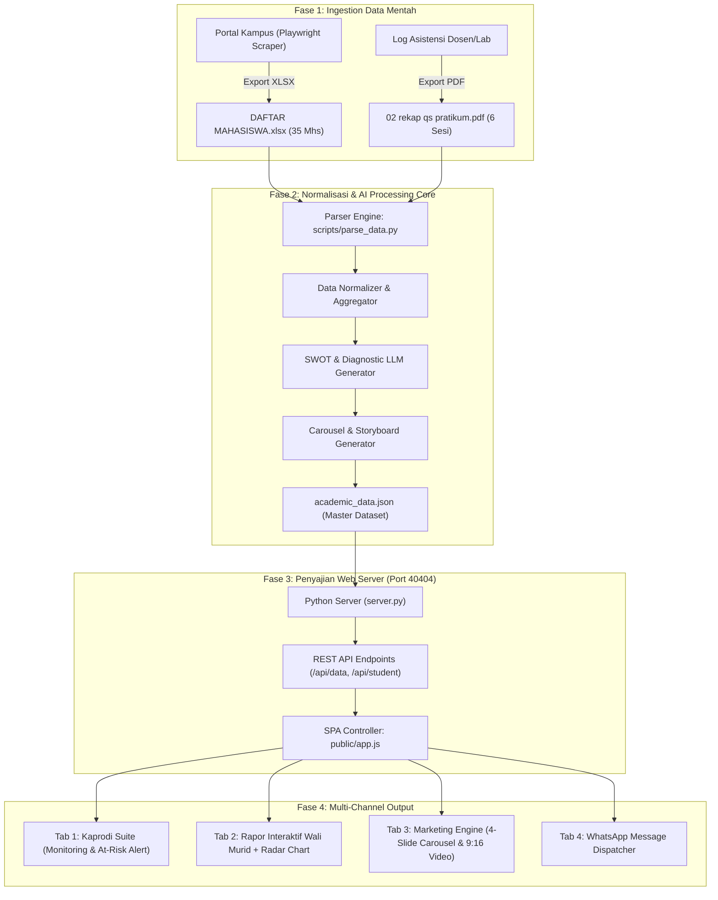

# WORKFLOW MAPPING & ARSITEKTUR SISTEM
## SIAK-KAPRODI (Sistem Intelijen Akademik & Rekap Portofolio Arsitektur)

Dokumen ini memetakan alur data ujung-ke-ujung (End-to-End Pipeline) dari sumber portal kampus hingga menjadi alat monitoring Kaprodi, rapor interaktif wali murid, dan mesin viral marketing media sosial.

---

### 🗺️ Diagram Alur Data Sistem

---

### 🏛️ Pemetaan 4 Modul Fungsional Utama

#### 1. Modul Presensi & Rekap Bulanan (Kaprodi View)
* **Tujuan**: Memberikan visibilitas 100% kepada Kaprodi mengenai disiplin perkuliahan per bulan.
* **Fitur**:
  * KPI Cards: Tingkat kehadiran kelas (%), distribusi status (Hadir, Sakit, Izin, Alpha).
  * Filter Sesi: Pertemuan 1 s/d 6 (AutoCAD dasar, Kolom Dinding, Layer Arsiran, Potongan & Pondasi, Layout A3, Perhitungan Volume).
  * Log Alasan: Setiap ketidakhadiran mencantumkan alasan otentik (surat dokter, delegasi lomba, kendala perangkat).
  * At-Risk Student Alert: Sistem otomatis menandai mahasiswa dengan akumulasi Alpha $\ge 2$ atau kehadiran $< 75\%$ untuk intervensi dini sebelum ujian.

#### 2. Modul Evaluasi Kinerja & Analisis AI (Wali Murid View)
* **Tujuan**: Laporan berkala yang humanis, komprehensif, dan mudah dipahami orang tua.
* **Fitur**:
  * Pemilihan Mahasiswa Instan: Dapat berganti profil antar 35 mahasiswa.
  * Radar Chart 5 Dimensi: Penguasaan CAD, Ketelitian Detail, Kedisiplinan Asistensi, Logika Ruang/Struktur, Manajemen Waktu.
  * AI SWOT Card:
    * 🟢 **Kekuatan**: Menyoroti potensi bakat unik mahasiswa.
    * 🟡 **Kelemahan**: Aspek teknis yang perlu diperbaiki.
    * 💡 **Saran Wali Murid**: Rekomendasi peran orang tua di rumah untuk mendampingi putra/putrinya.

#### 3. Modul Mesin Viral Marketing (Creative Media Loop)
* **Tujuan**: Mengubah kebanggaan orang tua menjadi corong promosi organik kampus di WhatsApp Status dan Instagram.
* **Fitur**:
  * **4-Slide Instagram Carousel (Rasio 4:5 Portrait)**:
    * *Slide 1 (Cover)*: Foto mahasiswa + badge resmi prestasi prodi arsitektur.
    * *Slide 2 (Aktivitas)*: Foto proses asistensi dan dinamika di Lab Komputer LIKDA.
    * *Slide 3 (Karya)*: Gambar kerja digital nyata (Denah, Potongan Struktural, Detail Pondasi).
    * *Slide 4 (Pride & Closing)*: Watermark resmi prodi, pesan inspiratif, dan ajakan kuliah di Arsitektur.
  * **Vertical Video Recap (9:16 Reels/Shorts)**:
    * Simulasi video gerak vertikal 32 detik.
    * Narasi suara AI (Voiceover) yang mendeskripsikan progres belajar anak.
    * Format mobile-ready untuk dipajang langsung di status media sosial.

#### 4. Modul Simulator Distribusi WhatsApp
* **Tujuan**: Memudahkan pengiriman laporan tanpa perlu mengetik ulang manual.
* **Fitur**:
  * Format template pesan WA yang santun, formal, dan mencantumkan ringkasan nilai serta link rapor interaktif unik per mahasiswa.
  * Tombol 1-klik `Salin Pesan WA` dan `Buka WhatsApp Web`.

---

### 🔗 Integrasi dengan Ekosistem OpenCraft MCP (`E:\WORKSHOP\OPEN_CRAFT_MCP`)
Sistem ini terhubung secara arsitektural dengan framework otomasi konten kreatif:
1. **DesignCraft Skill**: Mengotomasi perakitan tata letak grafis dokumen arsitektur dan format rapor.
2. **Carousel-Template Skill**: Merender kartu carousel 4-slide menjadi file PNG/JPG resolusi tinggi (1080x1350) secara batch.
3. **FilmCraft / Shorts-Template Skill**: Merender video rekapan vertikal 9:16 menggunakan programmatic timeline dan background music prodi.
4. **DeckCraft Skill**: Mengekspor portofolio dan rekap kelas menjadi slide presentasi eksekutif untuk rapat senat / pimpinan fakultas.
