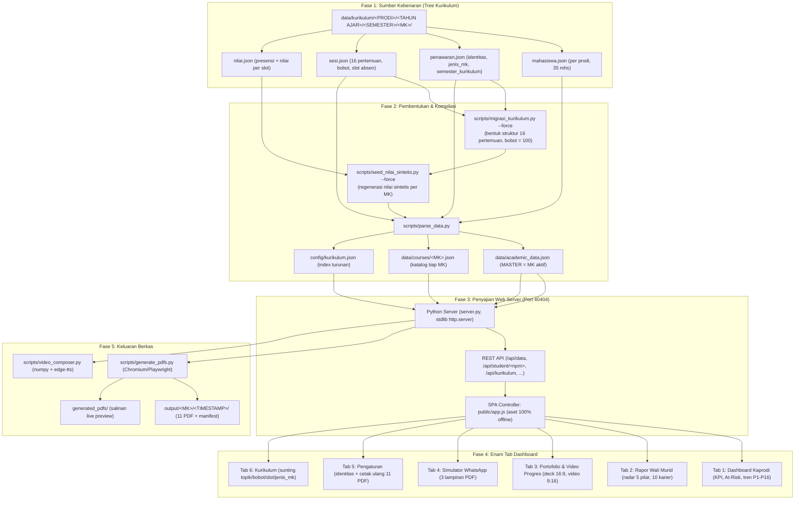

# WORKFLOW MAPPING & ARSITEKTUR SISTEM
## SIAK-KAPRODI (Sistem Intelijen Akademik & Rekap Portofolio Arsitektur)

Dokumen ini memetakan alur data ujung-ke-ujung (End-to-End Pipeline) dari **tree
kurikulum** sampai menjadi alat monitoring Kaprodi, rapor interaktif wali murid,
dan mesin publikasi media sosial.

> **Riwayat:** dokumen ini dulu menggambarkan alur **v2.5** (Excel/PDF mentah →
> JSON). Sejak **v2.6** kedua berkas mentah itu **tidak dipakai lagi** dan
> dianggap tidak ada; semuanya berdiri sendiri dari `data/kurikulum/`. Sejak
> `Commit C` nilai presensi/nilai sintetis juga **berbeda per mata kuliah**.
> Acuan angka yang berlaku tetap `README.md`; angka di dokumen ini adalah
> **struktur**, bukan klaim hasil.

---

### 🗺️ Diagram Alur Data Sistem (v2.6)



**Urutan yang benar** (kalau struktur atau nilai berubah):

```cmd
python scripts\migrasi_kurikulum.py --force      :: bentuk STRUKTUR (aman, tidak menghapus hasil edit)
python scripts\seed_nilai_sintetis.py            :: lihat dulu (dry run, tidak menulis)
python scripts\seed_nilai_sintetis.py --force    :: tulis nilai sintetis (backup otomatis)
python scripts\parse_data.py                     :: kompilasi master + katalog
```

Cetak ulang dokumen: `generate_all_pdfs.bat`, atau tombol **Tab 5 → Cetak Ulang
Paket PDF** (fail-closed: menolak kalau identitas belum diterapkan ke data).

---

### 🏛️ Pemetaan Modul Fungsional (6 Tab + Mesin)

#### 1. Tab Dashboard Kaprodi (`kaprodi`)
* **Tujuan**: visibilitas penuh Kaprodi atas disiplin perkuliahan & nilai satu MK.
* **Fitur**:
  * KPI: rata-rata kehadiran (per **slot** absen), rata-rata nilai, jumlah At-Risk, tingkat kelulusan.
  * Distribusi status: **Hadir, Hadir Sebagian, Sakit, Izin, Alpha, Belum Diinput** (6 keranjang, bukan 4).
  * Grafik per pertemuan **P1–P16** dengan garis patokan *Benchmark Kelas* yang dibaca dari data.
  * **At-Risk Alert**: akumulasi Alpha $\ge 2$ **atau** kehadiran $< 75\%$ (ambang di `config/aturan.json`).
  * Pemilih mata kuliah (katalog `data/courses/`) — ganti MK memicu kompilasi ulang master dari tree.

#### 2. Tab Rapor Wali Murid (`wali`)
* **Tujuan**: laporan humanis & berorientasi masa depan, tanpa ranking kompetitif.
* **Fitur**:
  * **Zero Competitive Ranking**: diganti Status Kompetensi + Indeks Kesiapan Profesi + Predikat.
  * Radar Chart 5 dimensi (AutoCAD, Detail & Presisi, Kedisiplinan Asistensi, Logika Ruang & Struktur, Manajemen Waktu).
  * 4 kuadran narasi diagnosis (karakter spasial, proyeksi potensi, catatan penguatan, panduan pendampingan wali).
  * Matriks 10 rekomendasi profesi (Architectural Designer, BIM Modeler, QS, DED Specialist, Interior Architect, 3D Visualizer, Site Architect, Landscape Architect Assistant, Green Building Specialist, Project Planner/Kontraktor) + persentase kecocokan.
  * Rincian 16 pertemuan: skor, status, alasan; pertemuan belum lengkap tampil **"Belum Diinput"** dan grade ditahan **"Belum Lengkap"**.

#### 3. Tab Portofolio & Video Progres (`marketing`)
* **Tujuan**: mengubah capaian mahasiswa menjadi bahan presentasi & publikasi.
* **Fitur**:
  * **DeckCraft 16:9** (4 slide widescreen) per mahasiswa, bisa dipratinjau penuh di web.
  * **Video vertikal 9:16** (storyboard + narasi afirmatif) dari `scripts/video_composer.py`; contoh hasil render ada di `public/videos/`.
  * Aset contoh di repo: **11 PDF** arsip (termasuk 3 deck portofolio 16:9) + 2 video.

#### 4. Tab Simulator WhatsApp (`whatsapp`)
* **Tujuan**: mengirim laporan resmi ke wali murid langsung dari sistem.
* **Fitur**: format pesan santun + 3 lampiran PDF (`01_rekap_kehadiran_*`, `02_rapor_akhir_semester_*`, `05_deckcraft_*`), tombol salin pesan & buka WhatsApp Web.

#### 5. Tab Pengaturan (`pengaturan`)
* **Tujuan**: satu tempat untuk identitas institusi & penerbitan ulang dokumen.
* **Fitur**:
  * Sunting identitas (ketua prodi, NIP, dosen, asisten) melalui `config/identitas.json` — **nama tidak boleh tersebar di kode**.
  * Tombol **Terapkan ke Dokumen** lalu **Cetak Ulang Paket PDF** (11 berkas). Endpoint menolak (409) kalau masih ada identitas yang belum diterapkan, supaya kop baru tidak menyilang dengan isi data lama.
  * Bidang yang belum diketahui sengaja **dibiarkan kosong**, tidak dikarang.

#### 6. Tab Kurikulum (`kurikulum`)
* **Tujuan**: mengelola struktur perkuliahan tanpa menyentuh berkas JSON manual.
* **Fitur**:
  * Pohon **PRODI → TAHUN AJAR → SEMESTER → MK → 16 pertemuan**.
  * Sunting topik, deskripsi, bobot per pertemuan, jumlah slot absen, `jenis_mk`, `semester_kurikulum`.
  * Validasi **Σ bobot = 100** dan rentang nilai; ditolak (422) **tanpa menulis berkas** kalau tidak lolos.
  * Status `tebakan` vs `dikonfirmasi` tidak bisa naik sendiri — harus lewat suntingan manusia.

#### Mesin di belakang layar (bukan tab, tapi bagian alur)
| Modul | Peran |
| --- | --- |
| `scripts/kurikulum_tree.py` | Sumber kebenaran path/berkas tree: baca & tulis atomik (LF), index, `validasi_sesi` (16 pertemuan, UTS/UAS, Σ bobot = 100), hitung menit jadwal |
| `scripts/persona.py` | Persona mahasiswa dari NPM (bukan nomor baris) + RNG **per NPM dan per MK** + pembangkit catatan presensi/nilai sintetis |
| `scripts/seed_nilai_sintetis.py` | Satu pintu regenerasi `nilai.json`: dry run, backup, tolak berkas non-`sintetis`, lapor SHA |
| `scripts/kelas_rules.py` | Satu-satunya tempat aturan nilai: bobot, grade, At-Risk, status pertemuan, "Belum Diinput" |
| `scripts/aturan.py` | Pembaca + validator `config/aturan.json` (fail-closed kalau rusak) |
| `scripts/identitas.py` | Pembaca/penulis `config/identitas.json` (backup dulu, tulis atomik) |
| `scripts/parse_data.py` | Kompilasi master + katalog; **tidak mengarang** nilai — membacanya dari tree |
| `scripts/process_input.py` | Menyimpan snapshot olahan per MK ke `input/processed/` |
| `scripts/generate_pdfs.py` | Merender 11 PDF resmi lewat Chromium (Playwright) |
| `scripts/video_composer.py` | Merender video 9:16 (numpy + edge-tts) |
| `scripts/index_kurikulum.py` | Membangun ulang `config/kurikulum.json` dari folder; `--check` untuk mendeteksi drift |
| `scripts/fetch_vendor.py` | Mengunci aset pihak ketiga ke `public/vendor/` supaya dashboard jalan **offline** |

---

### 🧪 Peta Pengujian (12 berkas, tanpa server kecuali yang disebut)

| Berkas | Yang dijaga |
| --- | --- |
| `tests/test_rules_unchanged.py` | Membangun ulang dari data yang sama harus menghasilkan **angka identik** |
| `tests/test_readme_accuracy.py` | Setiap angka di README harus ada di data (anti angka karangan) |
| `tests/test_docs_dependensi.py` | Impor kode ↔ `requirements.txt` (tanpa paket mati), nomor port seragam, rute `/api` ↔ `REQUIREMENTS.md`, dan dokumen tidak lagi mengklaim alur v2.5 |
| `tests/test_aturan.py` | Ambang At-Risk & grade hidup di config dan benar-benar berpengaruh |
| `tests/test_belum_diinput.py` | Slot belum terisi ≠ Alpha ≠ nilai 0; bobot dinormalisasi; grade ditahan |
| `tests/test_seed_per_mk.py` | Nilai sintetis beda per MK, reproducible, persona tidak berpindah, absen tidak mendarat di UTS/UAS |
| `tests/test_migrasi_non_destruktif.py` | `--force` tidak menghapus hasil edit manusia & tidak menimpa `nilai.json` |
| `tests/test_kurikulum_tree.py` | 16 pertemuan, validasi sesi, index anti-drift, path aman |
| `tests/test_kurikulum_api.py` | API sunting kurikulum: fail-closed, tulisan atomik, status tebakan vs dikonfirmasi |
| `tests/test_catalog_guard.py` | Ganti MK tidak bisa memundurkan data master (409 katalog lama) |
| `tests/test_identitas.py` | Identitas sinkron dengan data, tidak ada nama yang di-hardcode di kode |
| `tests/test_server_http.py` | HTTP/1.1, byte-range video, path traversal, guard server ganda (butuh server hidup) |

---

### 📂 Struktur Direktori (yang benar-benar ada)

```text
E:\WORKSPACE\KAMPUS_01\
├── config/                       # aturan.json (ambang & grade), identitas.json, kurikulum.json (index)
├── data/
│   ├── kurikulum/<PRODI>/<TA>/<SEMESTER>/<MK>/{penawaran,sesi,nilai}.json   # SUMBER KEBENARAN
│   ├── courses/<MK>.json         # katalog hasil kompilasi (artefak, jangan disunting manual)
│   ├── academic_data.json        # MASTER untuk MK aktif
│   └── _backup/                  # cadangan otomatis (gitignored)
├── input/                        # snapshot mentah/olahan per MK (raw/, processed/, progress_mahasiswa/)
├── output/<MK>/<TIMESTAMP>/      # 11 PDF + manifest.json  (latest_run.json menunjuk yang terbaru)
├── generated_pdfs/               # salinan PDF untuk pratinjau web
├── public/                       # index.html, app.js, style.css, vendor/ (aset offline), videos/
├── scripts/                      # mesin: tree, persona, rules, migrasi, seed, parse, pdf, video
├── tests/                        # 12 berkas regresi (lihat peta di atas)
├── server.py                     # server stdlib, port 40404
├── README.md                     # acuan utama
├── REQUIREMENTS.md               # kebutuhan teknis & prasyarat
├── WORKFLOW_MAPPING.md           # dokumen ini
├── requirements.txt              # paket pip
├── setup.bat                     # pasang dependensi + Chromium + data awal
├── run_server.bat / stop_server.bat
├── process_input.bat             # olah input per MK + cetak PDF
├── generate_all_pdfs.bat         # cetak ulang paket PDF
└── generate_video_shorts.bat     # render video 9:16
```

---

### 🔒 Aturan yang Tidak Boleh Dilanggar (dijaga tes)

1. **Tree = sumber kebenaran.** `data/courses/` dan `data/academic_data.json` adalah **artefak**; kalau berbeda, tree yang benar.
2. **Tidak mengarang angka.** Nilai dibaca dari `nilai.json`, bukan digenerate saat kompilasi.
3. **Belum diinput ≠ Alpha.** Pertemuan yang slotnya belum lengkap keluar dari rata-rata (bobot dinormalisasi) dan grade ditahan "Belum Lengkap"; perilaku lama bisa dipulihkan lewat `config/aturan.json`.
4. **Fail-closed.** Berkas rusak, bobot ≠ 100, atau berkas non-`sintetis` → berhenti dan lapor, jangan menebak.
5. **Satu sumber aturan.** Ambang At-Risk, grade, dan bobot hidup di `kelas_rules.py` + `config/aturan.json`, tidak disalin ke berkas lain.
6. **Identitas tidak di kode.** Nama orang/institusi hanya di `config/identitas.json`.
7. **Tidak ada angka di dokumen resmi yang diketik manual** — `test_readme_accuracy.py` mengunci itu.
