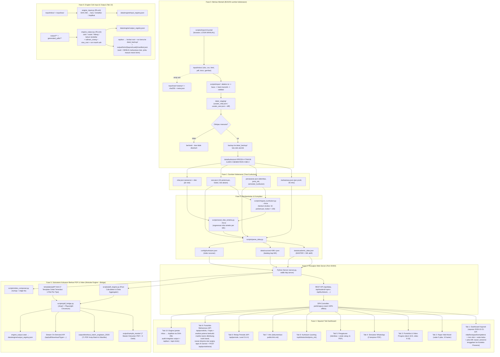

# WORKFLOW MAPPING & ARSITEKTUR SISTEM
## SIAK-KAPRODI (Sistem Intelijen Akademik & Rekap Portofolio Arsitektur)

Dokumen ini memetakan alur data ujung-ke-ujung (End-to-End Pipeline) dari **tree
kurikulum** sampai menjadi alat monitoring Kaprodi, rapor interaktif wali murid,
dan mesin publikasi media sosial.

> **Riwayat:** dokumen ini dulu menggambarkan alur **v2.5** (Excel/PDF mentah →
> JSON). Sejak **v2.6** kedua berkas mentah itu **tidak dipakai lagi** dan
> dianggap tidak ada; semuanya berdiri sendiri dari `data/kurikulum/`. Sejak
> `Commit C` nilai presensi/nilai sintetis juga **berbeda per mata kuliah**.
> Tambahan terbaru: **Tab 9 Portofolio Mahasiswa** — laporan 4 lapis lintas SEMUA
> MK + analisis potensi dari nilai (cluster kanal bidang → dimensi khas estimasi
> → matriks karier bonus sebidang; `README.md` §12 untuk rinciannya). Acuan angka
> yang berlaku tetap `README.md`; angka di dokumen ini adalah **struktur**, bukan
> klaim hasil.

---

### 🗺️ Diagram Alur Data Sistem (v2.6)



**Urutan yang benar** (kalau struktur atau nilai berubah):

```cmd
python scripts\migrasi_kurikulum.py --force      :: bentuk STRUKTUR (aman, tidak menghapus hasil edit)
python scripts\seed_nilai_sintetis.py            :: lihat dulu (dry run, tidak menulis)
python scripts\seed_nilai_sintetis.py --force    :: tulis nilai sintetis (backup otomatis)
python scripts\parse_data.py                     :: kompilasi master + katalog
```

Cetak ulang dokumen: `generate_all_pdfs.bat`, atau tombol **Tab 5 → Cetak Ulang
Paket PDF** (fail-closed: menolak kalau identitas belum diterapkan ke data).

---

### 🏛️ Pemetaan Modul Fungsional (10 Tab + Mesin)

#### 1. Tab Dashboard Kaprodi (`kaprodi`)
* **Tujuan**: visibilitas penuh Kaprodi atas **mutu capaian** kelas satu MK; disiplin jadi konteks, bukan bintang.
* **Fitur (reposisi 2026-10-21, kompetensi-first)**:
  * KPI: **Rata Nilai Studio** (bintang), **Indeks Kesiapan Kelas** (rata `indeks_kesiapan`), **Kompetensi Kelas** (rata 5 dim + jujur berapa dim punya komponen terukur), **Perlu Pendampingan** (At-Risk).
  * Chart **Tren Nilai Kelas per Pertemuan** (rata skor praktikum lintas mahasiswa, ikut filter bulan) + **Radar Kompetensi Kelas** + Distribusi Grade.
  * **Peta MK Rawan**: 5 MK rata nilai terendah lintas semester dari tree (`/api/periode?semua_semester=1`); klik Detail = drill-down kurikulum **tanpa mengubah MK aktif**.
  * **Konteks Presensi** (collapsible bawah): tabel presensi + filter bulan/sesi/status + Tren Kehadiran P1–P16 — tetap lengkap, bukan lagi muka dashboard.
  * **At-Risk**: akumulasi Alpha $\ge 2$ **atau** kehadiran $< 75\%$ (ambang di `config/aturan.json`).
  * Pemilih mata kuliah (katalog `data/courses/`) — ganti MK memicu kompilasi ulang master dari tree.

#### 2. Tab Rapor Wali Murid (`wali`)
* **Tujuan**: laporan humanis & berorientasi masa depan, tanpa ranking kompetitif.
* **Fitur**:
  * **Zero Competitive Ranking**: diganti Status Kompetensi + Indeks Kesiapan Profesi + Predikat.
  * Radar Chart 5 dimensi (AutoCAD, Detail & Presisi, Kedisiplinan Asistensi, Logika Ruang & Struktur, Manajemen Waktu).
  * 4 kuadran narasi diagnosis (karakter spasial, proyeksi potensi, catatan penguatan, panduan pendampingan wali).
  * Matriks 10 rekomendasi profesi (Architectural Designer, BIM Modeler, QS, DED Specialist, Interior Architect, 3D Visualizer, Site Architect, Landscape Architect Assistant, Green Building Specialist, Project Planner/Kontraktor) + persentase kecocokan.
  * Rincian 16 pertemuan: skor, status, alasan; pertemuan belum lengkap tampil **"Belum Diinput"** dan grade ditahan **"Belum Lengkap"**.

#### 3. Tab Portofolio & Video Progres (`marketing`)
* **Tujuan**: mengubah capaian mahasiswa menjadi bahan presentasi & publikasi.
* **Fitur**:
  * **DeckCraft 16:9** (4 slide widescreen) per mahasiswa, bisa dipratinjau penuh di web.
  * **Video vertikal 9:16** (storyboard + narasi afirmatif) dari `scripts/video_composer.py`; contoh hasil render ada di `public/videos/`.
  * Aset contoh di repo: **11 PDF** arsip (termasuk 3 deck portofolio 16:9) + 2 video.

#### 4. Tab Simulator WhatsApp (`whatsapp`)
* **Tujuan**: mengirim laporan resmi ke wali murid langsung dari sistem.
* **Fitur**: format pesan santun + 3 lampiran PDF (`01_rekap_kehadiran_*`, `02_rapor_akhir_semester_*`, `05_deckcraft_*`), tombol salin pesan & buka WhatsApp Web.

#### 5. Tab Pengaturan (`pengaturan`)
* **Tujuan**: satu tempat untuk identitas institusi & penerbitan ulang dokumen.
* **Fitur**:
  * Sunting identitas (ketua prodi, NIP, dosen, asisten) melalui `config/identitas.json` — **nama tidak boleh tersebar di kode**.
  * Tombol **Terapkan ke Dokumen** lalu **Cetak Ulang Paket PDF** (11 berkas). Endpoint menolak (409) kalau masih ada identitas yang belum diterapkan, supaya kop baru tidak menyilang dengan isi data lama.
  * Bidang yang belum diketahui sengaja **dibiarkan kosong**, tidak dikarang.

#### 6. Tab Kurikulum (`kurikulum`)
* **Tujuan**: mengelola struktur perkuliahan tanpa menyentuh berkas JSON manual.
* **Fitur**:
  * Pohon **PRODI → TAHUN AJAR → SEMESTER → MK → 16 pertemuan**.
  * Sunting topik, deskripsi, bobot per pertemuan, jumlah slot absen, `jenis_mk`, `semester_kurikulum`.
  * Validasi **Σ bobot = 100** dan rentang nilai; ditolak (422) **tanpa menulis berkas** kalau tidak lolos.
  * Status `tebakan` vs `dikonfirmasi` tidak bisa naik sendiri — harus lewat suntingan manusia.

#### 7. Tab Info (`info`)
* **Tujuan**: dokumentasi sistem dibaca dari `public/info.md` (di-cache setelah sukses), dirender tanpa pustaka eksternal.

#### 8. Tab Rekap Periode (`rekap`)
* **Tujuan**: visibilitas KAPRODI lintas mata kuliah — bukan cuma satu MK.
* **Fitur**:
  * **Level 3** (satu semester, semua MK): grid per MK — peserta, kehadiran, nilai rata, At-Risk, pertemuan X/16, topik terisi/placeholder, cakupan bulan.
  * **Level 4** (semua semester, semua MK): rollup digrup per tahun ajar & semester.
  * Dihitung dari **tree** oleh `scripts/periode.py` (bukan master 1 MK); At-Risk **per MK**; pertemuan belum diinput **netral**; cache per MK ber-tanda mtime.
  * Fail-closed: prodi tak dikenal 400, semester tidak ada 404, MK berkas tidak lengkap tampil "rusak" sisa MK tetap jalan.
  * Tombol "Detail Kurikulum" menyelip konteks tab 6 — **tanpa** memindahkan MK aktif (tidak memicu kompilasi ulang).
  * Pelengkap di tab 1: dropdown **Bulan** (Level 1, grup "Tanpa Tanggal" terpisah) + badge periode master (Level 2).

#### 9. Tab Portofolio Mahasiswa (`portofolio`)
* **Tujuan**: laporan **satu mahasiswa lintas semua MK** — bukan cuma MK aktif —
  dalam 4 lapis (per bulan → per MK → per semester → sepanjang kuliah), plus
  **analisis potensi yang dibangun dari NILAI**.
* **Fitur**:
  * Dropdown 35 mahasiswa → KPI 4 lapis + accordion 6 semester (kartu MK +
    chip bulanan), 4 tombol unduh PDF (termasuk **PDF 06 Portofolio Lengkap**).
  * Endpoint `GET /api/portofolio?npm=<NPM>` dari `scripts/portofolio.py`
    (kini pembungkus tipis kompilasi fitur `scripts/fitur_mahasiswa.py`
    — Zona 2: satu buka katalog **per MK** ber-stempel `mtime+ukuran`,
    bukan per NPM; sumber: katalog build `data/courses/` = SEMUA MK di tree;
    fail-closed npm kosong 400 / tak dikenal 404 / katalog rusak tidak
    membatalkan laporan).
  * **Analisis Potensi**: label potensi & ambang **pinjam satu sumber**
    `scripts/diagnosis.py` (mesin templat v3, tanpa RNG); radar 5 dim lintas MK
    dengan sumber jujur (`terukur` hanya kalau semua MK penopang terukur).
  * **Bidang terkuat (`scripts/bidang.py`)**: cluster 5 kanal (Studio Desain,
    Teknologi & Komputer, Struktur & Konstruksi, Bangunan-Lingkungan, Humaniora)
    dari keyword MK; kanal terkuat menjadi pusat analisis (mk tertinggi = kasus
    utama); **dimensi khas bidang** comot 70% rata nilai kanal + 30% radar
    terukur dan **seluruhnya dilabel estimasi**.
  * **Matriks karier sepanjang kuliah**: 10 karier dari radar lintas MK; karier
    sekanal dapat bonus +4 (clamp cap karier), karier lain tetap tampil.

#### 10. Tab Engine (`engine`)
* **Tujuan**: pusat pemeriksa **input & output yang dipecah dua** — data tidak
  diproses dua kali, output tidak ditulis ulang tanpa alasan — dan prasyarat
  **mesin kirim otomatis** (kaprodi & wali murid) yang datang nanti.
* **Fitur**:
  * **Pusat Input** (`scripts/engine_input.py`, `GET/POST /api/engine/input`):
    pindai `input/inbox/` + bukti arsip `input/raw/`; pencocokan lewat
    **SHA-256** (bukan nama berkas): `baru` / `terdaftar` / **`duplikat`**
    (kembaran dilaporkan); tombol tandai "sudah diproses" fail-closed
    (sha tidak dikenal → 404).
  * **Pusat Output** (`scripts/engine_output.py`, `GET/POST /api/engine/output`):
    audit integritas **utuh / rusak / hilang / belum terdaftar** dari registry
    `data/engine/output_registry.json` + chip **salinan usang** (salinan
    `generated_pdfs/` beda SHA run terbaru) + chip **sisa root** + status run
    masih sah; chip lapis kirim.
  * **Rapikan + Lapis Kirim** (dengan konfirmasi, tombol busy "Memproses…"):
    brokat berkas di root `output/` + run lama & sisa folder tanpa manifest
    pindah ke `data/_backup/output_lama_<stamp>/`, **run terbaru selamat**;
    lapis `output/kirim/{kaprodi,wali}/manifest.json` dibangun dari sumber
    terverifikasi — wali mencantumkan **SEMUA mahasiswa tree** (yang belum
    berkas ditandai jujur); pintu masuk mesin kirim otomatis (dikecualikan dari
    pemindaian run, `/api/runs` aman).
  * Auto-load tab hanya **pertama kali per sesi** (pindai menulis registry;
    buka ulang pakai tombol manual).
  * Aturan tulis yang dijaga engine: berkas lama **utuh & tanda sama →
    diberikan apa adanya** (`guna_lama`); overwrite bila **tanda maju** —
    logika/format penyajian (`FORMAT_V` naik) ATAU **stempel data
    master+katalog berubah** (`data=<stamp>`) — ATAU **ukuran berkas tidak
    cocok** dengan tercatat (korup/parsial). Generator paket mengecek
    `run_masih_sah()` dulu: run duplikat dibatalkan sebelum Chromium menyala.

#### Mesin di belakang layar (bukan tab, tapi bagian alur)
| Modul | Peran |
| --- | --- |
| `scripts/engine_input.py` | **Engine pemeriksa INPUT (terpisah dari output)**: pindai `input/inbox/` + arsip `input/raw/`, deteksi data masuk yang pernah diproses via **SHA-256** → baru/terdaftar/duplikat; registry `data/engine/input_registry.json` dilindungi `threading.RLock` (server concurrent); tandai-diproses fail-closed |
| `scripts/engine_output.py` | **Engine pemeriksa OUTPUT (terpisah dari input)**: putusan tulis `siapkan()` (guna_lama / overwrite_logika / overwrite_integritas / tulis_ulang_pertama), tanda logika memuat **stempel data master+katalog** (`data=<stamp>`) + `FORMAT_V`, `stempel_data()`, `run_masih_sah()` pintu skip cetak paket (manifest run memuat `data_stamp`+`format_v`), pencatatan `catat()`, `audit()` (+ salinan_usang, sisa_root), `rapikan()` (sapu root + arsip run lama + lapis kirim `output/kirim/` dengan SEMUA mahasiswa tree); registry dilindungi RLock |
| `scripts/kurikulum_tree.py` | Sumber kebenaran path/berkas tree: baca & tulis atomik (LF), index, `validasi_sesi` (16 pertemuan, UTS/UAS, Σ bobot = 100), hitung menit jadwal |
| `scripts/persona.py` | Persona mahasiswa dari NPM (bukan nomor baris) + RNG **per NPM dan per MK** + pembangkit catatan presensi/nilai sintetis |
| `scripts/seed_nilai_sintetis.py` | Satu pintu regenerasi `nilai.json`: dry run, backup, tolak berkas non-`sintetis`, lapor SHA |
| `scripts/kelas_rules.py` | Satu-satunya tempat aturan nilai: bobot, grade, At-Risk, status pertemuan, "Belum Diinput" |
| `scripts/periode.py` | Agregasi rekap per-periode DARI TREE (`/api/periode`): per MK / per semester / rollup semua; At-Risk per MK, belum-diinput netral, cache ber-tanda mtime |
| `scripts/diagnosis.py` | **Mesin diagnosis v3 (templat, tanpa RNG)**: klasifikasi sinyal nyata dari nilai/kinerja, radar terukur berlabel, narasi templat v2, matriks 10 karier deterministik + bonus sebidang. Satu sumber ambang/label untuk tab wali, tab 8, tab 9 & PDF |
| `scripts/fitur_mahasiswa.py` | KOMPILASI FITUR satu mahasiswa dari katalog all MK (Zona 2): indeks per-MK ber-stempel `mtime+ukuran` (satu buka per MK sepanjang umur proses, hanya MK basi dibaca ulang), transformasi 4 lapis + analisis potensi dipindah utuh dari portofolio lama |
| `scripts/portofolio.py` | Pembungkus tipis `fitur_mahasiswa.kumpulan` (`/api/portofolio`): API lama tetap (`kumpulan_portofolio`, `_label_potensi`, `_isis_detail_bulanan`), konsumen tidak terusik |
| `scripts/bidang.py` | Peta 5 kanal bidang MK (keyword kunci/nama), dimensi khas per kanal + trafo estimasi (70% nilai kanal + 30% radar terukur, selalu label estimasi), konstanta bonus karier sebidang — satu sumber untuk tab 9 & PDF 06 |
| `scripts/aturan.py` | Pembaca + validator `config/aturan.json` (fail-closed kalau rusak) |
| `scripts/identitas.py` | Pembaca/penulis `config/identitas.json` (backup dulu, tulis atomik) |
| `scripts/parse_data.py` | Kompilator master v2.6 dari tree; **stempel per-MK (Tangga B)**: `stempel_kompilasi()` = sha1 sumber yang menentukan isi master MK itu (tree MK + mahasiswa prodi + aturan + kurikulum + identitas minus penunjuk aktif); stempel sama + snapshot ada → master = **salinan bit-identik** `data/master_mk/<KUNCI>.json` tanpa kompilasi 12 s; `--compile-ulang` memaksa penuh |
| `scripts/process_input.py` | Menyimpan snapshot olahan per MK ke `input/processed/` |
| `scripts/pdf_engine.py` | **PDF Core Data Engine**: Agregasi data murni, kalkulasi bobot 100%, 10 karir AI Otak-CR, formula serapan 30 MK $S_{MK}$ & beban $L$, deteksi 4-blok burnout B1..B4 |
| `scripts/pdf_bridge.py` | **PDF Bridge Renderer**: Adapter visual Jinja2 + Playwright Chromium (CLI 1 master, CLI 7 master, on-demand streaming API) |
| `scripts/generate_pdfs.py` | Facade & Compatibility Layer ramping (115 baris) yang mendelegasikan ke `pdf_engine` dan `pdf_bridge` |
| `scripts/video_composer.py` | Merender video 9:16 (numpy + edge-tts) |
| `scripts/index_kurikulum.py` | Membangun ulang `config/kurikulum.json` dari folder; `--check` untuk mendeteksi drift |
| `scripts/fetch_vendor.py` | Mengunci aset pihak ketiga ke `public/vendor/` supaya dashboard jalan **offline** |
| `scripts/impor/cli.py` | Satu pintu perintah: `pindai`, `portal`, `impor`, `tinjau`, `terima`, `modul`, `usul`, `terima-sesi`, `status-ai` |
| `scripts/impor/portal.py` | Buka browser dengan **login manual**, simpan HTML + screenshot + tabel halaman ke `input/inbox/`; tanpa tabel = hanya arsip, bukan tebakan |
| `scripts/impor/kanonik.py` + `profil.py` | Normalisasi status/NPM/skor dan pemetaan header dari `config/impor/*.json`; header asing = berhenti, bukan ditebak |
| `scripts/impor/sumber_tabel.py` + `deteksi.py` | Baca xlsx/csv/html dan kenali jenis berkas dari magic bytes (bukan ekstensi) |
| `scripts/impor/nilai_impor.py` | Staging + diff + `terapkan()`: backup wajib, tulis atomik, mode `gabung`/`ganti`, idempoten |
| `scripts/impor/dokumen.py` | Ekstraksi teks PDF/DOCX per halaman/bagian; PDF scan ditandai `ocr_dibutuhkan` |
| `scripts/impor/ai_engine.py` + `analisis_mk.py` | Panggil engine Gemini rotary milik pengguna (bukan API baru) untuk mengusulkan topik/CPMK; hasil = staging "tebakan" |
| `scripts/ai_karier.py` | **Lapis B potensi karier berbukti (Gemini rotary)**: fail-closed (config hilang/rusak/aktif=false -> None, UI tetap Lapis A), verifikasi angka-subset bukti (angka karangan ditolak), cache `data/ai_karier_cache.json`, top-N karier teratas |

---

### 🧪 Peta Pengujian (24 berkas, tanpa server kecuali yang disebut)

| Berkas | Yang dijaga |
| --- | --- |
| `tests/test_periode.py` | Agregasi periode dari tree: sinkron angka dengan master, belum-diinput netral (kehadiran `None`), Sakit/Izin ≠ Alpha, rollup pohon konsisten, cache mtime usang sendiri |
| `tests/test_diagnosis.py` | Mesin v3 deterministik: klasifikasi sinyal nyata dari nilai/kinerja, radar terukur berlabel, 35 narasi unik, matriks karier tanpa RNG, bonus sebidang +4 & clamp cap |
| `tests/test_portofolio.py` | Portofolio 4 lapis: aturan bulanan netral, fail-closed, determinism + cache, label potensi = `AMBANG` diagnosis.py, cluster kanal bidang (dedup MK kembar), dimensi khas selalu `estimasi`, matriks karier sepanjang kuliah |
| `tests/test_karier_berbukti.py` | Potensi karier berbukti (Lapis A): skor sekanal ditimbang bukti kanal 70/30, bukti angka nyata dari MK & dimensi penopang, narasi dinamis terverifikasi, deterministik & cap profesi |
| `tests/test_karier_ai_failclosed.py` | Lapis B AI karier fail-closed: config hilang/rusak/aktif=false -> fallback aman Lapis A, verifikasi angka (angka karangan dibuang), cache per-NPM, integrasi endpoint POST `/api/portofolio/ai` |
| `tests/test_engine.py` | Engine input & output TERPISAH: duplikat via SHA-256 (isi sama nama beda), tandai-diproses fail-closed, siklus tulis guna_lama → overwrite_logika/integritas/tulis_ulang_pertama (catatan tanpa ukuran), stempel data (master berubah → tanda maju), `run_masih_sah` (sah / stempel maju / format maju / pdf korup), audit salinan_usang, regroup npm, rapikan (run terbaru selamat, brokat root disapu, lapis kirim + wali SEMUA mahasiswa tree |
| `tests/test_parse_stempel.py` | Tangga A+B: stempel kompilasi deterministik & beda antar MK, registry fail-closed, jalur segar = salinan snapshot < 5 s (bukan 12 s), `--compile-ulang` penuh + stempel sinkron kembali |
| `tests/test_rules_unchanged.py` | Membangun ulang dari data yang sama harus menghasilkan **angka identik** |
| `tests/test_readme_accuracy.py` | Setiap angka di README harus ada di data (anti angka karangan) |
| `tests/test_docs_dependensi.py` | Impor kode ↔ `requirements.txt` (tanpa paket mati), `openpyxl`/`pypdf`/`python-docx` hanya dari `scripts/impor/` + tesnya, `PyPDF2` dilarang, nomor port seragam, rute `/api` ↔ `REQUIREMENTS.md`, dokumen tidak lagi mengklaim alur v2.5 |
| `tests/test_impor_kanonik.py` | Alias status portal, Alpha wajib skor 0, NPM float Excel, dan penolakan pertemuan/slot/NPM di luar tree |
| `tests/test_impor_tabel.py` | CSV/XLSX/HTML → baris sama, staging tidak menulis, backup wajib, mode `gabung`/`ganti`, impor dua kali byte-identik |
| `tests/test_impor_dokumen.py` | PDF ber-text vs scan (OCR flag), DOCX per heading + tabel, gambar perlu OCR, pemotongan AI tidak kehilangan halaman |
| `tests/test_impor_portal.py` | Tangkapan portal: HTML + screenshot diarsipkan, tabel diekstrak ke CSV/XLSX, halaman tanpa tabel tidak membuat berkas palsu |
| `tests/test_impor_analisis.py` | Usulan AI offline: merge tanpa duplikasi, tolak pertemuan kurang / bobot ≠ 100 / halaman asing / placeholder, tulis `sesi.json` hanya setelah lolos |
| `tests/test_aturan.py` | Ambang At-Risk & grade hidup di config dan benar-benar berpengaruh |
| `tests/test_belum_diinput.py` | Slot belum terisi ≠ Alpha ≠ nilai 0; bobot dinormalisasi; grade ditahan |
| `tests/test_seed_per_mk.py` | Nilai sintetis beda per MK, reproducible, persona tidak berpindah, absen tidak mendarat di UTS/UAS |
| `tests/test_migrasi_non_destruktif.py` | `--force` tidak menghapus hasil edit manusia & tidak menimpa `nilai.json`, mendukung bobot desimal (bobot_lama float) |
| `tests/test_kurikulum_tree.py` | 16 pertemuan, validasi sesi, index anti-drift, path aman |
| `tests/test_kurikulum_api.py` | API sunting kurikulum: fail-closed, tulisan atomik, status tebakan vs dikonfirmasi |
| `tests/test_catalog_guard.py` | Ganti MK tidak bisa memundurkan data master (409 katalog lama) |
| `tests/test_identitas.py` | Identitas sinkron dengan data, tidak ada nama yang di-hardcode di kode |
| `tests/test_server_http.py` | HTTP/1.1, byte-range video, path traversal, guard server ganda (butuh server hidup) |

---

### 📂 Struktur Direktori (yang benar-benar ada)

```text
E:\WORKSPACE\KAMPUS_01\
├── config/                       # aturan.json (ambang & grade), identitas.json, kurikulum.json (index), impor/ (profil kolom)
├── data/
│   ├── kurikulum/<PRODI>/<TA>/<SEMESTER>/<MK>/{penawaran,sesi,nilai}.json   # SUMBER KEBENARAN
│   ├── courses/<MK>.json         # katalog hasil kompilasi (artefak, jangan disunting manual)
│   ├── academic_data.json        # MASTER untuk MK aktif
│   ├── courses/<MK>.json         # katalog build SEMUA MK (sumber tab 9/portofolio; artefak)
│   ├── master_mk/<KUNCI>.json    # snapshot per-MK + master_stamps.json (cache runtime Tangga B; gitignored)
│   ├── _backup/                  # cadangan otomatis (gitignored)
│   └── _staging/                 # usulan impor/AI yang belum disetujui (gitignored)
├── input/                        # snapshot mentah/olahan per MK
│   ├── inbox/                    # taruh berkas portal di sini (dipindai Engine Input; gitignored)
│   ├── raw/<MK>/<stamp>/         # arsip asli + sha256 + meta.json (bukti "pernah masuk")
│   └── processed/, progress_mahasiswa/
├── output/
│   ├── kirim/{kaprodi,wali}/manifest.json  # LAPIS KIRIM untuk mesin kirim otomatis (engine)
│   └── <MK>/<TIMESTAMP>/         # 11 PDF + manifest.json  (latest_run.json menunjuk yang terbaru)
├── generated_pdfs/               # salinan PDF untuk pratinjau web
├── public/                       # index.html, app.js, style.css, info.md, vendor/ (aset offline), videos/
├── scripts/                      # mesin: tree, persona, rules, migrasi, seed, parse, pdf, video, diagnosis, portofolio, bidang, engine_input, engine_output, impor/
├── tests/                        # 24 berkas regresi (lihat peta di atas)
├── server.py                     # server stdlib, port 40404
├── README.md                     # acuan utama
├── REQUIREMENTS.md               # kebutuhan teknis & prasyarat
├── WORKFLOW_MAPPING.md           # dokumen ini
├── requirements.txt              # paket pip
├── setup.bat                     # pasang dependensi + Chromium + data awal
├── run_server.bat / stop_server.bat
├── process_input.bat             # olah input per MK + cetak PDF
├── generate_all_pdfs.bat         # cetak ulang paket PDF
└── generate_video_shorts.bat     # render video 9:16
```

---

### 🔒 Aturan yang Tidak Boleh Dilanggar (dijaga tes)

1. **Tree = sumber kebenaran.** `data/courses/` dan `data/academic_data.json` adalah **artefak**; kalau berbeda, tree yang benar.
2. **Tidak mengarang angka.** Nilai dibaca dari `nilai.json`, bukan digenerate saat kompilasi.
3. **Belum diinput ≠ Alpha, dan tidak menekan kehadiran.** Pertemuan yang slotnya belum lengkap keluar dari rata-rata (bobot dinormalisasi), keluar dari **penyebut persen kehadiran**, dan grade ditahan "Belum Lengkap"; kehadiran yang belum bisa dihitung sama sekali = netral (`None`, bukan 0%); perilaku lama bisa dipulihkan lewat `config/aturan.json`.
4. **Fail-closed.** Berkas rusak, bobot ≠ 100, atau berkas non-`sintetis` → berhenti dan lapor, jangan menebak.
5. **Satu sumber aturan.** Ambang At-Risk, grade, dan bobot hidup di `kelas_rules.py` + `config/aturan.json`, tidak disalin ke berkas lain.
6. **Identitas tidak di kode.** Nama orang/institusi hanya di `config/identitas.json`.
7. **Tidak ada angka di dokumen resmi yang diketik manual** — `test_readme_accuracy.py` mengunci itu.
8. **Berkas mentah tidak boleh langsung ke tree.** Portal/Excel/CSV/PDF harus lewat `scripts/impor` → `data/_staging/` → ditinjau → backup → tulis atomik. `nilai.json` yang bukan `sintetis` dan bukan hasil impor sebelumnya tidak ditimpa tanpa `--paksa` eksplisit.
9. **Analisis potensi jujur sumbernya.** Ambang & label potensi pinjam satu sumber `scripts/diagnosis.py` (tidak ada salinan ambang); dimensi khas bidang terkuat (`scripts/bidang.py`) **selalu berlabel `estimasi`** — 70% rata nilai kanal + 30% radar terukur, tidak pernah tampil sebagai fakta terukur; kehadiran `None` tidak bisa mengangkat label ke TINGGI.
10. **Portofolio memakai katalog SEMUA MK, bukan hitungan kedua.** Angka tab 9 & PDF 06 dibaca dari artefak `data/courses/` (hasil build tree yang sama dengan dashboard).
11. **Data masuk tidak diproses dua kali.** Engine Input (`scripts/engine_input.py`) mencocokkan lewat **SHA-256**, bukan nama berkas; berkas yang isi-nya sudah pernah masuk/diproses dilaporkan **duplikat** dan tidak boleh diserap ulang tanpa keputusan manusia.
12. **Berkas output lama yang utuh & tanda logika/format sama diberikan apa adanya.** Engine Output (`scripts/engine_output.py`) menulis ulang HANYA bila logika/format penyajian maju (`FORMAT_V` naik) atau ukuran berkas tidak cocok dengan tercatat (korup/parsial).
13. **Mesin kirim otomatis membaca lapis kirim, bukan menebak di arsip.** `output/kirim/{kaprodi,wali}/manifest.json` berisi referensi dari sumber terverifikasi (run terbaru + registry engine); foldernya dikecualikan dari pemindaian run dan **tidak boleh** diasumsikan sebagai run produksi `<MK>/<TIMESTAMP>/`.
